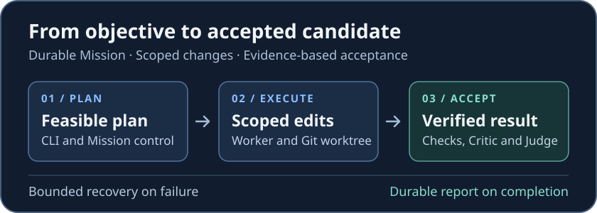

# LocalExecute

**Local-first autonomous coding with durable execution and verification-driven acceptance.**

LocalExecute turns a coding objective into bounded work in a separate Git worktree. It coordinates local models for planning, implementation and review, then uses configured checks and a Judge verdict to decide whether the candidate can be accepted. The public v0.1.0 prerelease is experimental, with offline qualification on Windows x64 and CPython 3.12.

[Overview](#why-localexecute) | [Architecture](#architecture) | [Quick Start](#quick-start) | [Configuration](docs/CONFIGURATION.md) | [Examples](docs/EXAMPLES.md) | [Validation](#validation) | [Security](#safety)



## Why LocalExecute?

An LLM can generate a patch. Completing a software task also means identifying the exact revision, limiting what the worker can change, running the required checks and making an auditable acceptance decision. LocalExecute keeps those responsibilities in the harness, along with durable state, rule-based model routing and bounded recovery.

## How it works

1. **Plan.** The CLI starts the guarded launcher. Mission control persists the objective and checks whether the plan can be executed.
2. **Route and edit.** Routing selects a model and execution profile. The worker uses scoped tools against a candidate Git worktree.
3. **Verify and review.** Required deterministic checks run against the candidate. The Critic provides advisory review. A valid Judge verdict and completion gates control acceptance.
4. **Complete or stop.** The controller writes durable status and a final report on completion. Failures can trigger bounded recovery or replanning. Accepted candidates are retained for inspection and manual integration.

[Full workflow and recovery diagram](docs/HOW_IT_WORKS.md)

## Capabilities

| Area | What is implemented | Qualification |
| --- | --- | --- |
| Execution | Durable Missions, planning, scoped tools, candidate worktrees and bounded recovery | Native SIMPLE and REPLAN lifecycle exercised offline |
| Models | Logical Lead, Worker, Critic and Judge roles, resource-aware routing and shared runtime ownership | Deterministic transport tests. Live startup and model behavior depend on the host and registry |
| Acceptance | Deterministic verification, advisory Critic, strict Judge and durable completion | Offline acceptance gates. No public live task success rate |
| Optional integrations | Research and sandbox components | Research primitives tested offline. Docker isolation qualified separately |

## Requirements

| Requirement | When needed |
| --- | --- |
| Windows x64, CPython 3.12, Git | Qualified source install and core workflows |
| Native Ollama and compatible local model tags | Live production startup and inference |
| Adequate available RAM and supported GPU placement | Live model admission. Context, quantization and resident set affect fit |
| Docker Desktop, with WSL 2 if using its WSL backend | Separate Docker sandbox workflows |
| Browser or search services | Only for explicitly configured optional research integrations |

## Quick start

From PowerShell with Git and CPython 3.12 installed:

```powershell
git clone https://github.com/KonstantinEgorenko/LocalExecute.git
Set-Location LocalExecute
git --version
py -3.12 --version
py -3.12 -m venv .venv
.\.venv\Scripts\python.exe -m pip install --require-hashes -r requirements/dev-win-py312.lock
.\.venv\Scripts\python.exe -m pip install --no-build-isolation --no-deps .
.\.venv\Scripts\localexecute.exe --version
.\.venv\Scripts\localexecute.exe --help
.\.venv\Scripts\python.exe -m harness.mission_runner --help
```

For live setup, follow the [Windows installation walkthrough](docs/INSTALLATION.md). It covers [Ollama and exact model tags](docs/OLLAMA_SETUP.md), shared lock provisioning, a separate trusted Git target, a dedicated state directory and a read-only preflight. Then review the optional guarded Mission command and decide whether to execute it.

The direct Mission preflight checks configuration, Git and server reachability without loading models. The production launcher can reconcile residency and calibrate the effective worker inventory **before** processing Mission arguments. Treat `--execute` as permission to call real models and run generated trusted code on the host.

## Architecture

| Component | Responsibility |
| --- | --- |
| Mission, workflow and scheduler | Persist objectives, dependency state, execution progress and completion |
| Router, executor and model runtime | Select bounded profiles and coordinate physical Ollama calls |
| Workspace and worktree | Authorize tool paths and isolate candidate edits from the target checkout |
| Verification, Critic and Judge | Validate candidate evidence, review changes and decide acceptance |

[System map](docs/ARCHITECTURE.md) · [Migration and descendant bootstrap](docs/MIGRATION.md) · [Model routing](docs/MODEL_ROUTING.md) · [Resources](docs/RESOURCE_MANAGEMENT.md) · [Verification](docs/VERIFICATION.md)

## Staging benchmark: LocalExecute vs mini-SWE-agent (November 2026)

An **experimental, eight-task, single-attempt** comparison of small, single-file Python bug fixes using the same locally served, quantized **DeepSeek-Coder-V2 16B** model. These results measure the *specific staging agent configurations*, not the general capabilities of either project or the published LocalExecute v0.1.0 release.

| Metric | LocalExecute Worker v0.1 | mini-SWE-agent equal | mini-SWE-agent native |
| --- | ---: | ---: | ---: |
| Model generations permitted per task | 4 | 4 | 8 |
| **Successful completed tasks** | **3/8 (37.5%)** | **0/8 (0%)** | **0/8 (0%)** |
| Independently validated patches (including unsubmitted) | **3/8** | 1/8 | 1/8 |
| Actual model generations | 25 | 32 | 57 |
| Generated tokens (total) | **3,029** | 5,587 | 8,588 |
| Total server inference time | **213.41 s** | 387.51 s | 668.36 s |
| Median server inference time per task | **27.52 s** | 41.31 s | 88.20 s |
| Effective output rate (generated tokens / total server inference seconds) | 14.19 tokens/s | 14.42 tokens/s | 12.85 tokens/s |
| Verified owned model unloads | 8/8 | 8/8 | 8/8 |

mini-SWE-agent produced a correct patch for `boundary-seat` in both modes but did not formally submit it. All three configurations used eight frozen tasks, temperature 0, context 4,096 and a response cap of 768 output tokens. **The equal mode compares a four-generation budget; native permits eight and is not a budget-matched comparison.** The interfaces also differ: SHA-guarded `READ_TEXT`/`WRITE_TEXT` with pre-write tests versus containerized Bash and post-run validation. GPU offload was limited (`num_gpu=1`); observed model GPU residency (~319 MiB) is **not** total/peak VRAM use. The study is too small to establish general superiority.

[Full benchmark methodology, per-task outcomes, token throughput and resource measurements](docs/benchmarks/localexecute-vs-mini-swe-agent.md).

## Validation

**v0.1.0 public offline baseline: 428 passed, 2 intentional skips.** The release used deterministic model transport and separately qualified Docker isolation. See the [validation record and capability matrix](docs/VALIDATION.md).

## Safety

Native verification runs trusted code under your host account. Git worktrees and Windows Job ownership provide isolation of changes and process lifecycle control. Treat neither as a sandbox for malicious code. Docker primitives are separate from the default native verification path. Acceptance requires evidence bound to the exact candidate. The private independent evaluator is absent from the public distribution, and an explicit requirement for it blocks acceptance.

[Security and trust boundaries](docs/SECURITY.md) · [Docker setup](docs/DOCKER_SETUP.md) · [Troubleshooting](docs/TROUBLESHOOTING.md) · [FAQ](docs/FAQ.md)

## Contributing and license

Created by Konstantin Egorenko. Distributed under [Apache-2.0](LICENSE). See [NOTICE](NOTICE) and the [contributor guide](docs/CONTRIBUTING.md).
