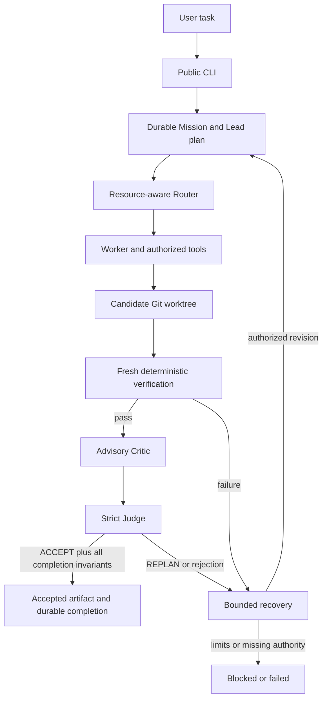
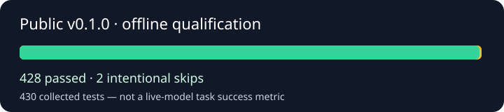

# LocalExecute

A local-first autonomous coding agent harness with durable execution, model routing, and verification-driven acceptance.

LocalExecute coordinates local models, scoped repository tools, deterministic checks and durable task state. It separates producing a candidate from the authority to accept it. This experimental project does not establish broad real-model autonomous task reliability.

[How it works](#how-it-works) | [Quick start](#quick-start) | [Architecture](docs/ARCHITECTURE.md) | [Validation](docs/VALIDATION.md) | [Security](docs/SECURITY.md) | [Contributing](docs/CONTRIBUTING.md)

## The Problem

A local LLM can generate code. Completing a coding task also requires authorized edits, reproducible verification, correct candidate identity, bounded failure handling and a truthful decision about completion.

## The Approach

The harness keeps task authority outside model output. Rule/score routing selects eligible profiles; workers use controlled Git worktrees. Fresh deterministic verification is mandatory. Critic supplies advisory evidence; Judge cannot override failed verification. Durable state supports bounded recovery and replanning. Shared locks serialize heavy GPU work. Optional research requires separate providers.

## Core Capabilities

- Durable Mission, scheduler and artifact state.
- Explicit model profiles and resource-aware routing.
- Scoped read/edit tools with content identity checks.
- Candidate-bound verification and review evidence.
- Bounded recovery, retained candidates and no automatic merge.
- Local model lifecycle, placement admission and shared GPU ownership.

## How It Works



## Quick Start

Qualified platform: Windows x64, CPython 3.12. Install Git; Docker Desktop is required only for separately configured Docker isolation. Models, Ollama and GPU drivers are external prerequisites.

```powershell
py -3.12 -m venv .venv
.\.venv\Scripts\python.exe -m pip install --require-hashes -r requirements/dev-win-py312.lock
.\.venv\Scripts\python.exe -m pip install --no-build-isolation --no-deps .
.\.venv\Scripts\localexecute.exe --help
```

Use a trusted Git-backed control checkout, a different trusted target Git repository and a dedicated state directory outside the target. Configure existing local models and a shared protected absolute GPU/runtime lock namespace. Never use independent per-project GPU locks.

Read-only readiness (does not qualify model placement or the full launcher):

```powershell
.\.venv\Scripts\python.exe -m harness.mission_runner --root "CONTROL_CHECKOUT" --workspace "TARGET_CHECKOUT" --state-root "OWNED_STATE" --profile production --mission-id "my-task" --goal "Update the implementation and add regression tests." --preflight
```

Production invocation below is an operator template, **not a validated successful live worked example**:

```powershell
.\.venv\Scripts\localexecute.exe run --root "CONTROL_CHECKOUT" --module harness.mission_runner -- --root "CONTROL_CHECKOUT" --workspace "TARGET_CHECKOUT" --state-root "OWNED_STATE" --profile production --mission-id "my-task" --goal "Update the implementation and add regression tests." --execute
```

Replace placeholders with absolute paths. The production launcher performs reconciliation and inventory-wide calibration **before** forwarding arguments, including `--preflight`; use the direct read-only route above for initial readiness. See [Getting started](docs/GETTING_STARTED.md).

## Architecture

[Component boundaries and model execution](docs/ARCHITECTURE.md) | [Task authority](docs/HOW_IT_WORKS.md) | [Configuration](docs/CONFIGURATION.md) | [Migration status](docs/MIGRATION.md)

## Validation Status



These are baseline release tests, not results of this unfinished refactor. Offline SIMPLE execution and REPLAN recovery were qualified with deterministic physical backends. The first live qualification stopped at preflight; the next stopped during startup calibration at the experiment safety threshold. No real-model Mission completion was proven. Subsequent analysis established partial attribution, not a proven model-specific OOM. See [Validation](docs/VALIDATION.md).

## Safety and Limitations

Native verification executes **trusted code on the host**. Git worktrees and process ownership are not a malicious-code sandbox. Docker isolation primitives are separately qualified and do not imply automatic Docker routing. Mandatory private V1 independent evaluation is unavailable and fails closed. Optional integrations and other platforms require separate qualification. No broad live-model success rate is established.

## Project Structure

Canonical implementations:

```text
harness/
  mission/ workflow/ recovery/
  router/ executor/ observability/
  workspace/ worktree/ verification/
  critic/ judge/ model_runtime/
  gpu_acceleration/ runtime_resources/
  external_evidence/ compatibility/
localexecute/
config/
docs/
```

Historical imports are handled by a centralized compatibility adapter; no physical legacy package directories are included. The old filesystem bootstrap path is intentionally retired: [Migration instructions](docs/MIGRATION.md).

## Contributing / License

Read [Contributing](docs/CONTRIBUTING.md) and [Security](docs/SECURITY.md). Apache-2.0 with [LICENSE](LICENSE) and [NOTICE](NOTICE). Created by Konstantin Egorenko.
