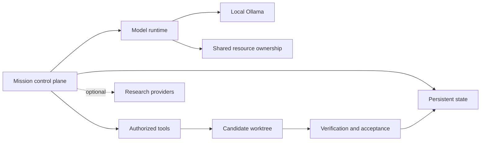
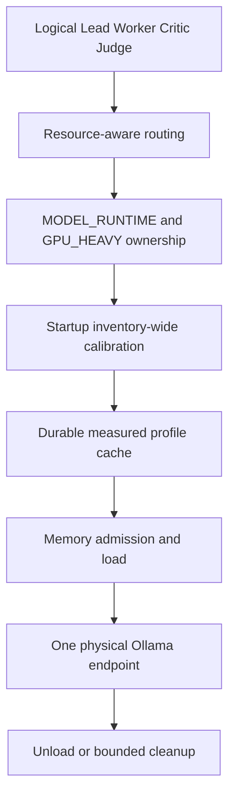
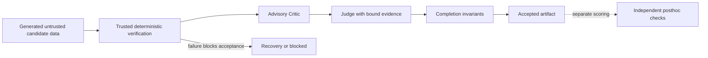

# Architecture

Canonical implementations separate control, model execution and acceptance. Native execution requires trusted targets.

## Local model execution

Calibration currently covers effective Worker inventory before Mission dispatch; demand-driven initialization is not implemented. The model-only policy constrains resident allocation to11264MiB and requires16384MiB available RAM. It does not prove a hard transient peak cap.

## Acceptance boundary

## Durable lifecycle

[Persisted Mission lifecycle diagram](architecture/mission-lifecycle.md).
