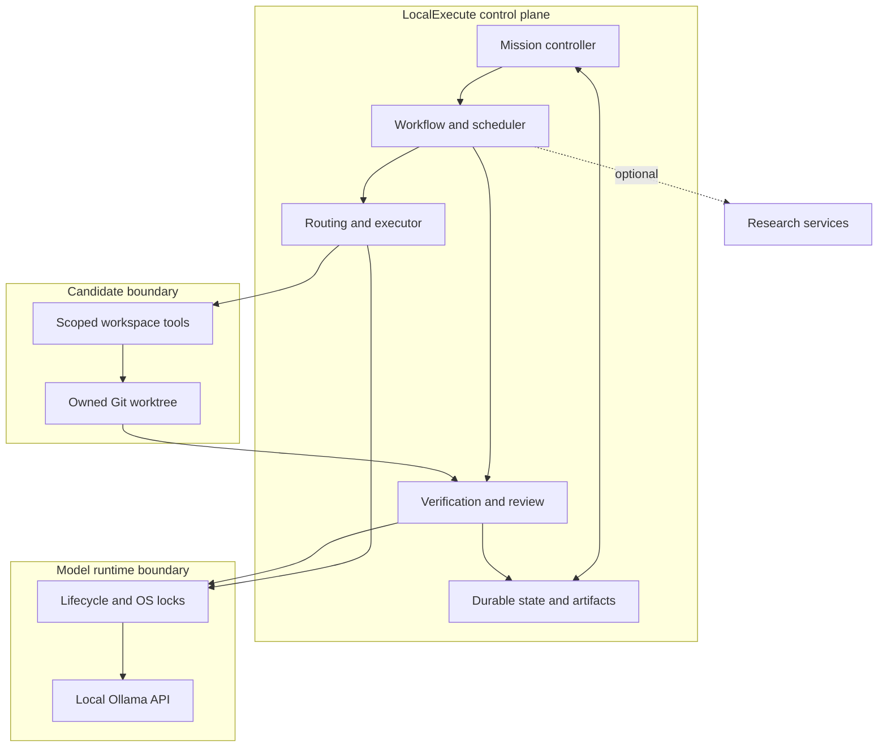
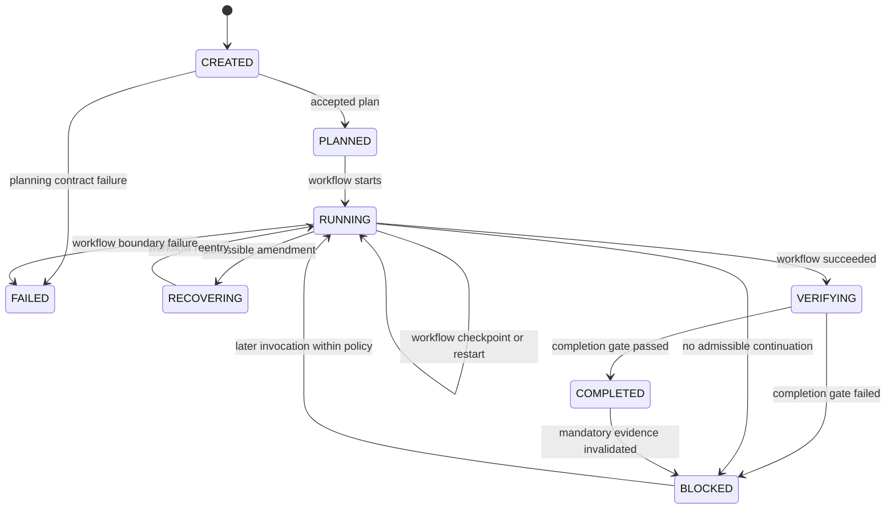
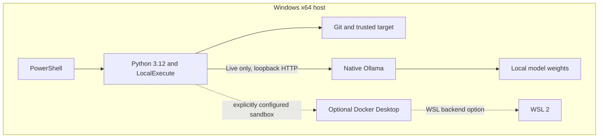

# Architecture

LocalExecute separates durable control, physical model execution, candidate mutation and acceptance. This guide describes the public v0.1.0 source layout, where semantic packages and some historical paths coexist.

| Area | Source entry points |
| --- | --- |
| Ingress and composition | [CLI](../localexecute/cli.py), [Mission runner](../harness/mission_runner.py), [production factory](../harness/integration/runtime_factory.py) |
| Durable control | [Mission controller](../harness/mission/controller.py), [workflow controller](../harness/workflow/controller.py), [scheduler](../harness/scheduler/) |
| Routing and execution | [Router](../harness/router/), [executor](../harness/executor/), [model runtime](../harness/model_runtime/) |
| Worktree and tools | [Workspace](../harness/workspace/), [worktree manager](../harness/worktree/manager.py) |
| Acceptance and recovery | [Verification](../harness/verification/), [Critic](../harness/critic/), [Judge](../harness/judge/), [recovery](../harness/recovery/) |

## Mission lifecycle

These edges summarize persisted transitions in the [Mission controller](../harness/mission/controller.py). A repair within a Todo need not change the Mission to `RECOVERING`. Mandatory evidence is revalidated on a completed restart.

## Windows setup boundary

See [installation](INSTALLATION.md), [Ollama](OLLAMA_SETUP.md) and [Docker](DOCKER_SETUP.md).
