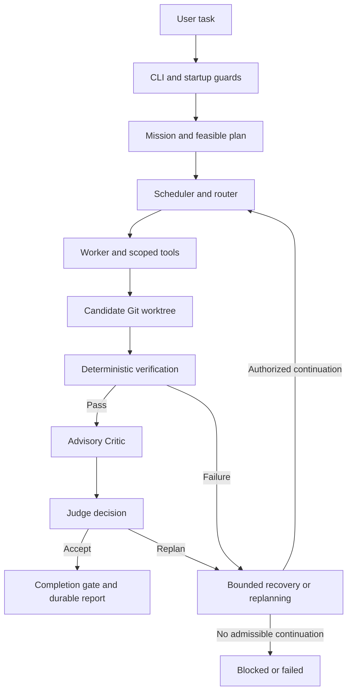

# From objective to accepted candidate

## Startup and ingress

The [CLI](../localexecute/cli.py) forwards `run` to the [production launcher](../harness/integration/production_launcher.py). The launcher installs process-local guards and the single-endpoint overlay, reconciles residency and ensures profiles for the effective worker inventory before entering the requested module. It can perform placement loads even when the Mission will never start. The direct `python -m harness.mission_runner --preflight` invokes only the read-only checks and should be run without the launcher.

## Plan, route and execute

The [Mission runner](../harness/mission_runner.py) builds a durable Mission spec from the objective. The [production factory](../harness/integration/runtime_factory.py) connects the planner, scheduler, repository context, workspace coordinator and execution adapters. The planner's structured response is compiled and checked for feasibility. Routing applies policy and profile constraints. The worker acts through scoped tools in the scheduler-owned candidate worktree. Execution may proceed through dependent Todos.

## Verify, review and complete

Configured deterministic checks run on identified candidate content. The Critic reports advisory findings and the Judge makes a structured decision with bound evidence. The Mission controller checks completion invariants and writes durable state and the final report. Verified candidates are retained for review. There is no automatic merge.

## Recover within policy

Verification or review may lead to a bounded repair, recovery or typed replan. The workflow may continue only with authorized workspace and state context. If the required evidence is missing, the budget is exhausted or the continuation is invalid, the Mission stops in the applicable state. See [the durable lifecycle](ARCHITECTURE.md#mission-lifecycle) and [verification](VERIFICATION.md).
