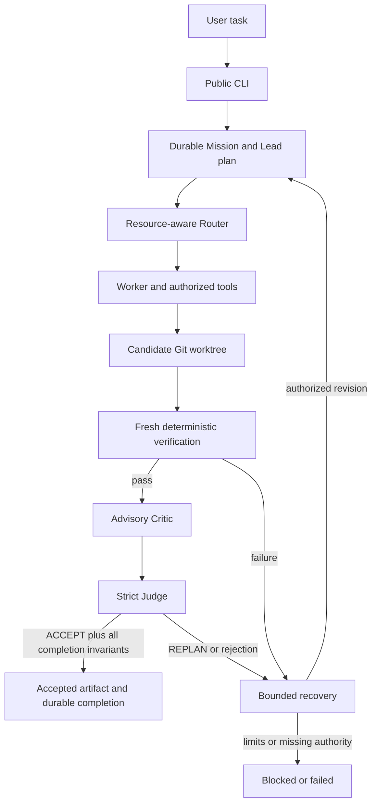

# How it works

Mission ingress preserves a task specification. Lead planning is compiled and checked; routing and workspace authority stay outside model discretion. Tools produce candidates, never acceptance. Fresh verification, strict review and completion invariants bind the accepted artifact. Durable recovery contexts do not substitute stale verification.

