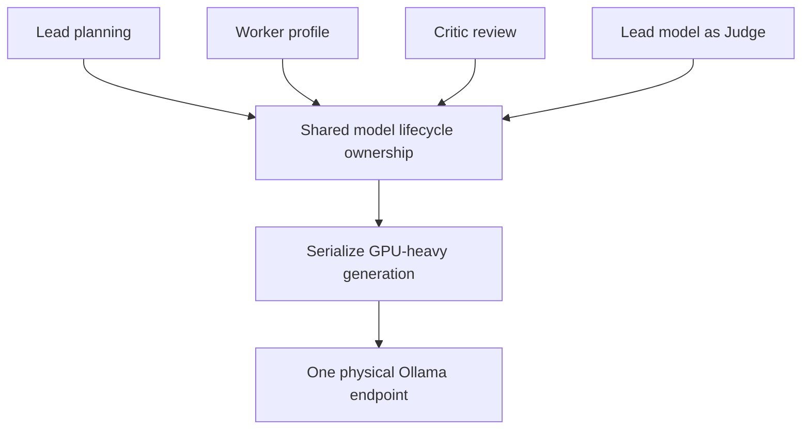

# Model routing

Logical roles describe responsibilities. The production launcher maps the configured logical endpoints onto one physical Ollama server without editing the YAML or starting a server. Selection uses rule and score policy, task context, profile eligibility and resource checks. Configuration entries are not promises that a model is installed, admitted or qualified.

- **Lead and Judge.** The Lead model plans, and Judge requests use the Lead runtime with a separate decision contract.
- **Worker.** The selected profile controls tools, model binding, context and generation limits. The durable execution shape and routing determine which role is needed next.
- **Critic.** The reasoning role reviews the candidate and evidence. Its output is advisory. The deterministic verifier and Judge retain their distinct authority.
- **Runtime.** Shared ownership gates residency and generation. Registry `execution: cpu` on the Lead is not proof that a production call ran without GPU acceleration. Inspect the [acceleration policy](../config/gpu_acceleration.yaml), effective options and actual residency.

Source references are the [router](../harness/router/), [executor profiles](../harness/executor/profiles.py), [single endpoint overlay](../harness/integration/single_endpoint.py), [runtime factory](../harness/integration/runtime_factory.py) and [model registry](../config/models.yaml).
