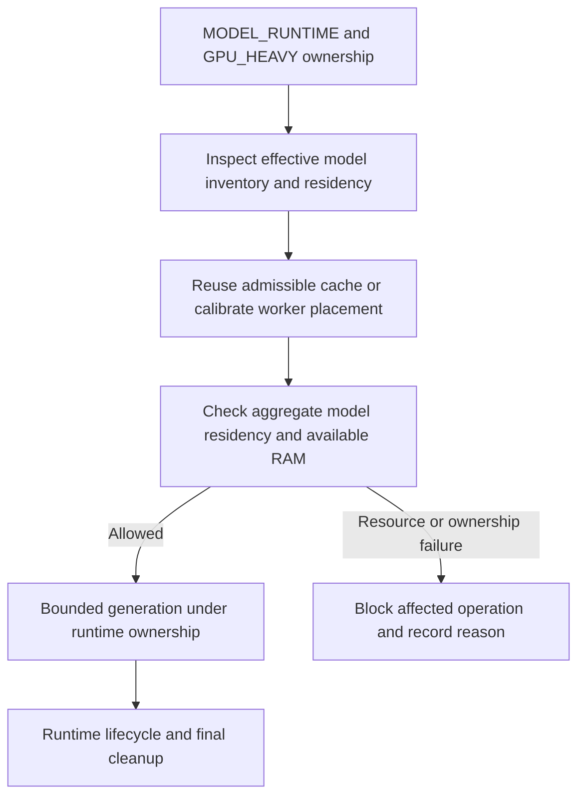

# Model resources and ownership

Production uses `MODEL_ONLY_HYBRID_GPU_RAM`. The active configuration budgets **11,264 MiB (11 GiB)** of aggregate accounted model residency and requires **16,384 MiB of available system RAM**. The current model-only policy has no additional fixed free-VRAM reserve. The legacy 1.5 GiB setting in [production_resources.yaml](../config/production_resources.yaml) is a different policy path. These values are policy inputs. They do not establish a minimum hardware specification or guarantee that a model can load.

## Placement and measurement

The backend can place some layers on GPU and retain other weights in system RAM where the profile supports offload. Context length and other backend allocations also affect memory. The runtime accounts for known LocalExecute model residents using Ollama `size_vram`. It inspects foreign residency separately and can block an operation rather than reclaim an unrelated model. Resident allocation is a snapshot. It does not establish a hard cap on transient peak GPU allocation.

Startup reconciles residency and ensures profiles across the effective GPU worker inventory before Mission dispatch. It may reuse a compatible measured cache or try bounded placement candidates. Calibration is not demand-driven by the selected Todo. Periodic adaptive GPU placement is not implemented.

## Lock namespace and cleanup

`MODEL_RUNTIME_LOCK_PATH` and `GPU_HEAVY_LOCK_PATH` must identify shared, protected absolute files across cooperating processes. The model lifecycle owner coordinates residency and the GPU lease serializes heavy inference. Model roles can share an endpoint without competing heavy generations. Verify actual resident state and ownership after an interruption. Do not remove an active lock file, unload unrelated models or reuse a candidate as if cleanup had succeeded.

See [runtime policy](../config/model_runtime.yaml), [GPU coordination](../config/gpu_coordination.yaml), [policy composition](../harness/integration/resource_policy.py), [accounting](../harness/model_vram.py) and [runtime lifecycle](../harness/model_runtime/runtime.py).
