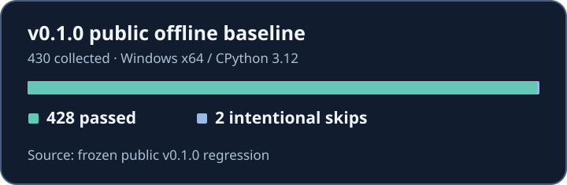

# Validation and qualification

## Published v0.1.0 baseline

Source data: the frozen public v0.1.0 Windows x64 / CPython 3.12 offline regression recorded **428 passed, 2 intentional skips, 430 collected**. The skips concern Windows symlink privileges. The chart reports counts only. See the [release notes](https://github.com/KonstantinEgorenko/LocalExecute/releases/tag/v0.1.0) for the published qualification scope and distribution hashes. The unmerged refactor's regression is separate evidence.

## Capability matrix

| Capability | Qualification | Evidence and boundary |
| --- | --- | --- |
| Native SIMPLE discovery and coding | Implemented and offline-qualified | [Native SIMPLE tests](../tests/test_public_native_simple.py) exercise real components with deterministic model transport. The native test substitutes Mission ingress |
| Bounded REPLAN draft recovery | Implemented and offline-qualified | [REPLAN draft tests](../tests/test_swarm_fix_replan_draft.py) exercise persisted transfer and recovery |
| Candidate verification and Judge authority | Implemented and offline-qualified | Public tests exercise deterministic and typed acceptance boundaries |
| Native production Mission with real local models | Implemented, live-unqualified for this public release | The observed public live attempt stopped during startup resource checks before Mission generation. No successful public real-model production Mission is established here |
| Docker isolation | Separately qualified primitive | Standalone isolation evidence. The [adapter](../harness/sandbox/docker_cli.py) is separate from the default native verification path |
| External research | Selected primitives offline-qualified | Real browser, search and other provider integrations require separate live qualification |
| Periodic adaptive GPU placement and demand-driven startup calibration | Not implemented | The current launcher checks the effective GPU worker inventory before dispatch |

The public release does not demonstrate a real-model success rate, performance comparison or universal hardware compatibility. The documentation-only update validates commands, links and presentation independently of the historical regression. See [verification](VERIFICATION.md) and [security](SECURITY.md).
