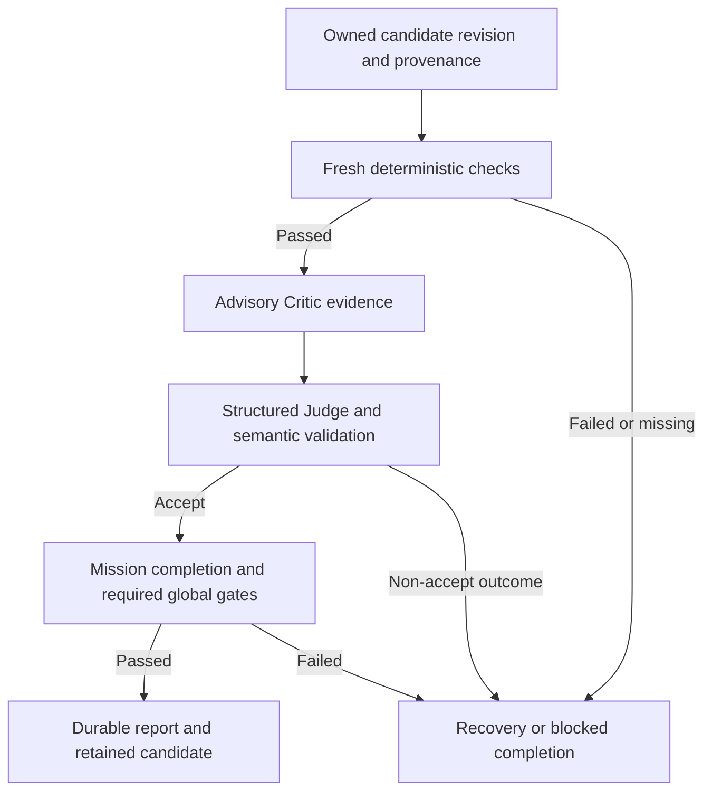

# Verification and acceptance

A worker's claim of completion is input to the workflow. Acceptance depends on evidence from configured checks and the Judge, tied to the candidate under review.

1. Candidate evidence ties the checks to the authorized worktree and revision. A later change requires the applicable fresh evidence.
2. Deterministic checks run according to the task and verification policy. Native commands can run candidate code on the host.
3. The Critic reviews the candidate and its evidence. The Judge must return a valid structured decision. A failed deterministic result or unresolved mandatory acceptance evidence cannot become an ACCEPT.
4. The Mission completion gate checks the applicable workflow and global evidence before terminal completion. Preserve verification reports, Judge receipts and the final report together.

Tests generated by the same worker can capture a regression, but do not supply independent ground truth. The private V1 independent evaluator is absent. A Mission that explicitly requires it fails closed, including terminal revalidation. Separate posthoc analysis can examine a provenance-bound candidate and cannot retroactively manufacture acceptance receipts.

Read the [verifier](../harness/verification/), [Judge protocol](../harness/judge/protocol.py), [Judge result invariants](../harness/judge/models.py) and [Mission controller](../harness/mission/controller.py).
