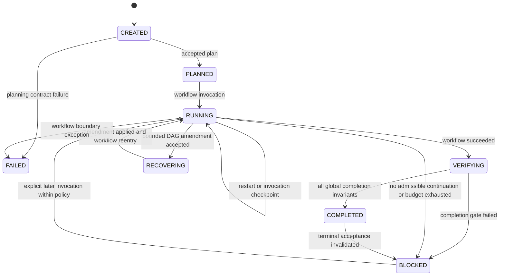

# Durable Mission lifecycle

These edges reflect persisted transitions in `harness/mission/controller.py`. Recovery within a Todo is a separate workflow concern; not every retry creates a Mission RECOVERING transition. COMPLETED can become BLOCKED on mandatory acceptance revalidation. FAILED remains terminal in this controller.

